<a href="https://kadirhanemrememis.xyz"><picture><source media="(max-width: 600px)" srcset="assets/hero-phone.svg"></picture></a>

<a href="https://github.com/search?q=author%3Akassvl+is%3Apr+is%3Amerged&type=pullrequests"><picture><source media="(max-width: 600px)" srcset="assets/vitals-phone.svg"></picture></a>

<a href="https://github.com/Git-Hospital"><picture><source media="(max-width: 600px)" srcset="assets/git-hospital-phone.svg"></picture></a>
<a href="https://github.com/Git-Hospital/helmbulance"><picture><source media="(max-width: 600px)" srcset="assets/tool-helmbulance-phone.svg"></picture></a>
<a href="https://github.com/Git-Hospital/meshmedic"><picture><source media="(max-width: 600px)" srcset="assets/tool-meshmedic-phone.svg"></picture></a>
<a href="https://github.com/Git-Hospital/boards"><picture><source media="(max-width: 600px)" srcset="assets/tool-boards-phone.svg"></picture></a>
<a href="https://github.com/Git-Hospital/githealthcheck"><picture><source media="(max-width: 600px)" srcset="assets/tool-githealthcheck-phone.svg"></picture></a>

<a href="https://github.com/search?q=author%3Akassvl+is%3Apr+is%3Amerged&type=pullrequests"><picture><source media="(max-width: 600px)" srcset="assets/head-open-source-phone.svg"></picture></a>
<a href="https://github.com/nordstjernen-web/nordstjernen-sol-browser/pulls?q=is%3Apr+author%3Akassvl"><picture><source media="(max-width: 600px)" srcset="assets/os-nordstjernen-web-nordstjernen-sol-browser-phone.svg"></picture></a>
<a href="https://github.com/getsentry/relay/pulls?q=is%3Apr+author%3Akassvl"><picture><source media="(max-width: 600px)" srcset="assets/os-getsentry-relay-phone.svg"></picture></a>
<a href="https://github.com/istio/istio.io/pulls?q=is%3Apr+author%3Akassvl"><picture><source media="(max-width: 600px)" srcset="assets/os-istio-istio-io-phone.svg"></picture></a>
<a href="https://github.com/nordstjernen-web/southstar-browser/pulls?q=is%3Apr+author%3Akassvl"><picture><source media="(max-width: 600px)" srcset="assets/os-nordstjernen-web-southstar-browser-phone.svg"></picture></a>
<a href="https://github.com/harfbuzz/harfbuzz/issues/6320"><picture><source media="(max-width: 600px)" srcset="assets/os-harfbuzz-harfbuzz-phone.svg"></picture></a>

<a href="https://kadirhanemrememis.xyz"><picture><source media="(max-width: 600px)" srcset="assets/work-phone.svg"></picture></a>

<a href="https://kadirhanemrememis.xyz"><picture><source media="(max-width: 600px)" srcset="assets/team-phone.svg"></picture></a>

<a href="https://kadirhanemrememis.xyz"><picture><source media="(max-width: 600px)" srcset="assets/stack-phone.svg"></picture></a>
