<a href="https://kadirhanemrememis.xyz"></a>

<a href="https://github.com/Git-Hospital"></a>

| Tool | What it does | Status |
| --- | --- | --- |
| [Helmbulance](https://github.com/Git-Hospital/helmbulance) | Installs a Helm chart on a throwaway kind cluster and runs day-2 scenarios: upgrades, reinstalls, Secret rotation, network isolation | pre-release |
| [MeshMedic](https://github.com/Git-Hospital/meshmedic) | Matches Istio's Prometheus telemetry against reviewed failure scenarios and opens a GitOps pull request with the diagnosis, evidence and rollback plan | v1.0.0 |
| [boards](https://github.com/Git-Hospital/boards) | Benchmark for diagnosis tools: known defects, clean twins and hand-verified values, scored by applying the fix | in development |
| [GitHealthCheck](https://github.com/Git-Hospital/githealthcheck) | Code health analyzer: tests, history, complexity. Every number is a measurement, or null with a reason | Go rewrite in progress |

## Shipped for clients

<table>
  <tr>
    <td width="50%" valign="top">
      <a href="https://braidss.xyz"></a>
      <br />
      <b><a href="https://github.com/kassvl/KulamaHairCare">Kulama Booking</a></b>, live at <a href="https://braidss.xyz">braidss.xyz</a><br />
      Website and booking system for a braiding studio. Guests request a slot and follow it on a
      private status page; the studio confirms, declines or offers a new time from its admin desk.<br />
      <sub>Next.js 16, React 19, TypeScript, Postgres, Tailwind v4, Vercel</sub>
    </td>
    <td width="50%" valign="top">
      <a href="https://loomr.net"></a>
      <br />
      <b>LOOMR</b>, live at <a href="https://loomr.net">loomr.net</a><br />
      Website for a fashion and textile design studio: a showroom you walk through and a garment
      configurator with live pricing.<br />
      <sub>Next.js 16, React 19, TypeScript, Canvas, Vercel</sub>
    </td>
  </tr>
</table>

## Work

| Where | What I do |
| --- | --- |
| **Bluesense** (Boston, remote) | iOS app in Swift and SwiftUI: session, checkout and cart fixes, release tooling, and GitHub automation for a team of about 30 |
| **[Nordstjernen](https://github.com/nordstjernen-web/nordstjernen-browser)** | Core contributor to an open-source browser engine in C: 200+ commits, made Google Search and Gmail sign-in work, reported a [HarfBuzz bug](https://github.com/harfbuzz/harfbuzz/issues/6320) fixed the same day |
| **BirthdayMessaging** (UK, remote) | Security scanning of a production messaging platform with OWASP ZAP, Burp Suite and nmap |

### Team products (private repos, happy to walk through the code)

| Project | What I did | Built with |
|---|---|---|
| **EmlakPlus** | Largest contributor (team of 4) to a CRM for real-estate agencies: listings, clients, map search, scheduled social posts | FastAPI, Next.js, PostgreSQL, Redis, Celery, Terraform |
| **data-stock** | REST API and admin web of an inventory SaaS that logs stock by barcode and syncs Amazon, Allegro and eBay listings | FastAPI, Alembic, React, Vite, Playwright |
| **Vantage** | TypeScript API of an Instagram analytics app: Graph API login, ad-supported free tier, Fly.io deploys | Node.js, TypeScript, Docker, Fly.io |

## Stack

```text
frontend   React, Next.js, TypeScript, Tailwind CSS, Framer Motion, Vite, React Native
backend    Python (FastAPI, Celery), Node.js (NestJS, Express), Go, REST, JWT/OAuth
data       PostgreSQL, Redis, SQLAlchemy + Alembic
testing    pytest, Vitest, Playwright, Jest, go test
platform   Docker, Kubernetes, Helm, Istio, GitHub Actions, Terraform, AWS, Vercel, Fly.io, Linux
```

<sub>B.Eng. Information Technology, WSB Merito Wrocław · Oracle Cloud Infrastructure 2025 Foundations Associate · Turkish, English (C1+), Polish (A2-B1)</sub>
